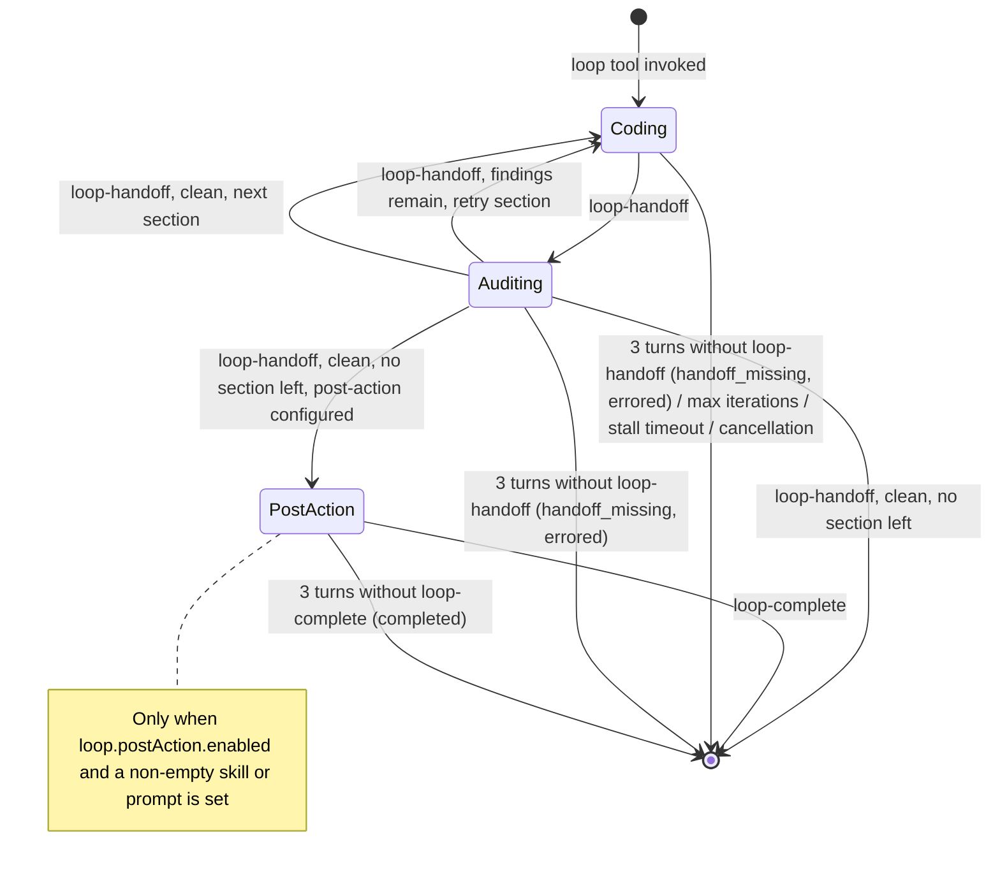
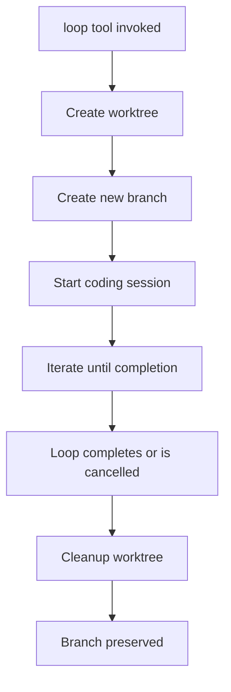

# Loop System Documentation

The loop system provides autonomous iterative development with automatic code auditing.

## Loop Lifecycle Rules

### Plugin Boot Behavior

- **Plugin boot does not mutate loop rows.** Initialization loads storage and runtime services only.
- No loops are recovered, cancelled, restarted, or reconciled during plugin startup.
- Loop recovery and restart are explicit user actions via `loop-status restart=true`.

### Restartability

- **Any non-completed loop is restartable** via explicit restart when the worktree is available.
- Restartable statuses: `running`, `cancelled`, `errored`, `stalled`.
- **Completed loops are history-only** and cannot be restarted.
- **A missing worktree blocks restart only when the scratch branch is gone too** — if the branch survives, restart recreates the worktree from it (`git worktree add <branch>`); when both are gone the work is unrecoverable.

### Restart Semantics

- Restart preserves loop identity, plan, worktree path, section progress, review findings, and per-loop sandbox settings (a loop launched with the sandbox off stays off; its resource overrides apply if the sandbox is recreated).
- Restart resets the iteration count to 1 and clears the error budget.
- Restart creates a fresh session and preserves the section index. An ordinary `auditing` phase restarts as `coding`, while an enabled `post_action` phase is preserved. Any standby session is discarded, so a restart never resumes retained context.
- Restart marks any pending handoff `discarded`, so the loop starts fresh with no turn record carried over from before the restart.
- Restarts into section coding with outstanding bug findings for the current section use the continuation prompt, including full finding details and the shared remediation policy; without current-section bugs, they use the initial section prompt.

### Stale Workspace Sweep

- Stale workspace sweep is **teardown cleanup-only**, not boot-time recovery.
- Sweep removes workspace registrations for non-running restartable loops (`cancelled`, `errored`, `stalled`) while preserving worktrees for manual restart.
- Completed loops are fully removed (registration + worktree).
- Running loops are never touched by sweep.

## Loop Lifecycle



### Phases

A loop has three persisted phases:

1. **`coding`** — a code session works on the current section or plan.
2. **`auditing`** — the auditor reviews the current section (or the whole change for a non-sectioned plan loop) against conventions and stored findings. A clean section audit advances to the next section, or completes the loop — into `post_action` when configured — when no section is still open.
3. **`post_action`** — an optional best-effort action after a clean audit.

Each completed code or audit pass rotates to a fresh session, except that a reusable standby session is resumed on same-section phase switches in both directions — coding → auditing and dirty audit → coding (see [Session Rotation](#session-rotation)); a new section always starts fresh. Audit findings feed back into the next coding iteration.

## Loop States

Each loop has a `LoopState` backed by the typed `loops` and `loop_large_fields` SQLite tables:

```typescript
interface LoopState {
  active: boolean                    // Whether loop is currently running
  sessionId: string                  // Current OpenCode session ID
  standbySessionId?: string          // Retained session for the next same-scope retry
  loopName: string                   // Unique loop identifier
  worktreeDir: string                // Worktree path
  projectDir?: string                // Project directory path
  worktreeBranch?: string            // Branch name if using worktree
  iteration: number                  // Current iteration count
  maxIterations: number              // Maximum iterations (0 = unlimited)
  startedAt: string                  // ISO timestamp
  prompt?: string                    // Original task prompt
  phase: 'coding' | 'auditing' | 'post_action'
  lastAuditResult?: string           // Last audit output
  errorCount: number                 // Consecutive error count
  auditCount: number                 // Number of audits completed
  terminationReason?: string         // Reason for termination
  completedAt?: string               // ISO timestamp
  worktree?: boolean                 // Whether using worktree isolation
  modelFailed?: boolean              // Whether model error occurred
  sandbox?: boolean                  // Whether using msb sandbox
  sandboxContainer?: string          // Sandbox name if sandboxed
  completionSummary?: string         // Summary of loop completion
  executionModel?: string            // Model used for execution
  auditorModel?: string              // Model used for auditing
  auditorFallbackIndex?: number      // Index into the auditor model fallback chain
  workspaceId?: string               // OpenCode workspace ID
  hostSessionId?: string             // Host session ID for post-completion redirect
  currentSectionIndex: number
  totalSections: number
}
```

Per-turn output lives in `loop_handoffs`, not on the loop row: only the current record is `pending`, it resolves to `applied` or `discarded`, and the resolved rows remain as history. `lastAuditResult` and `completionSummary` on the loop row are display text, never decision input.

## Handoff-Driven Turn Ends

A phase turn ends only through a persisted handoff row written by `loop-handoff` (coding, auditing) or `loop-complete` (post-action). The runtime never parses assistant text for decisions, summaries, markers, or completion. The audit verdict comes only from the findings store, and post-action completion only from the recorded `loop-complete` payload.

### `loop_handoffs`

| Column | Type | Meaning |
|--------|------|---------|
| `id` | integer | Auto-incrementing primary key |
| `project_id`, `loop_name` | text | Loop identity; the foreign key `(project_id, loop_name)` references `loops` with `ON DELETE CASCADE`, so deleting a loop removes its handoffs |
| `session_id` | text | Session that recorded the handoff |
| `role` | text | `coder`, `auditor`, or `post_action` (`CHECK` constraint) |
| `phase` | text | Phase at write time: `coding`, `auditing`, or `post_action` |
| `section_index` | integer / null | Current section for sectioned loops, `null` for non-sectioned plan loops |
| `iteration` | integer | Loop iteration at write time |
| `payload` | JSON text | Strictly validated role payload |
| `status` | text | `pending`, `applied`, or `discarded` (`CHECK` constraint) |
| `created_at`, `resolved_at` | integer | Write and resolution timestamps; `resolved_at` is `null` while pending |

A partial unique index (`idx_loop_handoffs_pending`) allows at most one `pending` row per loop, and a history index (`idx_loop_handoffs_loop`) keeps every resolved row in id order. Resolution is a single guarded update: marking a row `applied` matches on the recording `session_id`, the expected `role`, and `status = 'pending'`, and discarding matches `status = 'pending'`, so a record resolves exactly once.

Every payload is validated strictly against its role schema once on write, by `parseHandoffWriteInput` inside `recordHandoff` (the repository stores the already-validated payload and does not validate again before the insert), and on every read (`mapHandoffRow`). An invalid row is logged and skipped; its payload is never coerced or partially applied.

- **Coder payload** — `changes` (`{ summary, reason }`, at least one), `deviations` (`{ planItem, actual, reason }`), `verification` (`{ command, cwd, outcome: 'pass' | 'fail' | 'not-run', changedAfter }`, at least one), and optional `notes`.
- **Auditor payload** — optional `summary` (`{ done, deviations, followUps }`) and optional `notes`. `summary` is required for a clean section audit, forbidden while blocking bug findings remain, and forbidden in non-sectioned loops.
- **Post-action payload** — `outcome` (`completed`, `completed_with_issues`, or `failed`), `steps` (`{ name, status: 'done' | 'skipped' | 'failed', detail? }`, at least one), `followUps`, and optional `notes`.

Recording rules:

- Only the loop's current session may record a handoff; any other session is rejected.
- The tool must match the phase: `loop-handoff` in coding and auditing, `loop-complete` in post-action. The wrong tool is rejected.
- The call is rejected while any other loop session, subagents included, is busy or retrying, and rejected when that session status cannot be verified.
- The last call in the same turn replaces the earlier pending record instead of adding a second one.
- A successful call does not advance the loop. It only stores the record; the phase runner applies it when the turn ends.

Turn-end sequence:

1. In coding and auditing, a persisted provider-limit error is classified first and either terminates the loop or advances the auditor fallback chain.
2. The persisted assistant error is charged to the phase's error budget next: a model error marks the model as failed, and the third consecutive error terminates with `error_max_retries`. The turn then defers while any loop session other than the standby — the current session included — is busy or retrying, or a prompt is still queued in the session inbox. The deferral fails closed: a session status that cannot be verified keeps the turn deferred. In coding and auditing this wait runs before the phase acts on an assistant error, so an errored turn rotates only after every other loop session has settled. Post-action is the exception: an assistant error applies any pending record and completes best-effort before the wait.
3. `applyPendingHandoff` runs scoped to the current session and role and applies the record atomically, once, only while it is `pending`.

With a record the runner proceeds to `nextTransition`; a repeat resolution or a row recorded by a different session yields nothing. A pending row recorded by this session for the other role is left pending and logged, so the role that wrote it stays the one to apply it. Without a record:

- A turn with no reply at all — its last message role is `none` or `user` — is re-sent the full phase prompt.
- Any other turn receives the short nudge "You ended your turn without calling `loop-handoff`/`loop-complete`. Finish the work, then call it.", including one whose assistant reply was cut off (`finish` reason `length` or `tool-calls`).
- Each phase turn gets 3 nudges (`MAX_HANDOFF_NUDGES`); the count resets whenever a session is activated or the phase changes, including when a reused standby session is activated, so a previous turn's spent nudges never shorten the new turn's budget.
- After the third nudge the next idle ends the turn: coding and auditing terminate with `terminationReason: 'handoff_missing'` and status `errored`, while post-action completes as `completed`.

An abort-and-resend the loop itself initiates — auditor model fallback after a provider limit, or the busy-stall continue nudge — discards the pending handoff recorded in the aborted turn, so the resent turn starts with no record.

**Coding.** A `coder` record is stored as the attempt's decisions through `handoffCompletionKey(record)` and its rendered `formatCoderHandoff` output, then the `coder-handoff` transition rotates to auditing. An assistant error still rotates to audit, with no decisions recorded and no nudge.

**Auditing.** A non-abort audit session error discards the pending auditor handoff before rotating back to coding, without incrementing the audit count; an aborted audit turn that already holds an `auditor` record for the session is processed as a handoff instead. A clean section audit whose pending record carries no `summary` is discarded and the auditor is nudged rather than completing the section. With an `auditor` record the verdict comes only from the findings store, never from the payload; `lastAuditResult` is rendered from the payload and the verdict for display, and transition rows are logged as `auditor-handoff`: advancing to the next section, returning to the same dirty section, continuing a dirty non-sectioned audit, or entering post-action.

**Post-action.** A `post_action` record sets `postActionReport` from `formatPostActionReport` and `completionSummary` from `formatPostActionSummary`, then completes the loop. An assistant error applies any pending record best-effort and completes. The loop status is always `completed` regardless of the reported outcome, but a failed send of a post-action nudge goes through the normal prompt-error handling, so it can end the loop with `provider_limit` or count toward `error_max_retries`.

## Session Rotation

Each phase switch runs in a **fresh session** to keep context small and prioritize speed, unless the loop resumes its standby (see below):

1. **Coding phase** completes
2. New session is created
3. Continuation prompt is injected with:
   - Original task prompt
   - Current iteration number
   - Audit findings (if any)
4. The previous session is deleted once its usage is captured, unless the loop retained it as the standby

**Standby session.** `loops.standby_session_id` (migration 155) records at most one retained session, always the role opposite the current phase. It is the only way a loop resumes a session it had switched away from.

- When coding finishes and a fresh audit session is created, the coder becomes the standby — unless a bug finding has reached the recurrence escalation threshold, in which case it is deleted instead.
- When a dirty audit sends work back to coding, the coder is resumed from the standby instead of a new session, and the audit session becomes the standby in turn (an audit session that errored is deleted instead). A sectioned loop only ever reuses within the same section: a clean section audit releases the standby before the next section's fresh coder session. A non-sectioned loop reuses the standby across its audit iterations.
- Reuse requires `inspectReusableStandby` to pass: the standby is not the current session, still exists with messages, has no bug finding at the recurrence escalation threshold (`RECURRENCE_ESCALATION_THRESHOLD`, 3), and its role's reuse percentage is not `0` (`loop.sessionReuse.coderContextPercent` / `auditorContextPercent`, default 50 each; `0` disables reuse for that role). The role comes from the standby: the coder session while auditing, the audit session while coding. When its last assistant turn's context (input plus cache read/write) reached that percentage of the model's context window, the standby is not rejected: `inspectStandbyCandidate` marks it `needsCompaction`, and the loop queues a `session.compact` before the follow-up prompt so the host compacts the session first and the prompt runs in the same session against the summary. A compaction that cannot be enqueued falls back to the fresh-session path for that role. An unknown context window — no model on the message, a failed lookup, or no positive `limit.context` — allows reuse without compaction. Recurrence escalation forces a fresh session for both roles. When reuse fails, the loop rotates to a fresh session and captures the standby's usage before deleting it; the audit session is still retained as the next standby even when it is over its threshold, because it will be compacted when reused.
- A resumed coder receives `buildCoderFollowUpPrompt` — the loop notice, the open findings, and the coder handoff instruction — not the full plan; its earlier context still applies, compacted into a summary when the reuse threshold was reached. A resumed audit session receives `buildAuditFollowUpPrompt` — the coder's decisions, the attempt history, and a directive to re-read changed files (`git status` / `git diff`), verify every outstanding finding, and delete the resolved ones.
- Reused sessions are re-titled for the new iteration. A reused session's earlier reply is never mistaken for the new turn: turn completion comes only from a handoff row written by that session and applied once, scoped to it, so a stale reply cannot advance the phase. Compaction messages never reach the phase handlers: `session.messages` on the client port exposes only `user` and `assistant` records, so a compaction summary cannot be consumed as the coder's or auditor's reply. An idle between the queued compaction and the queued follow-up prompt is deferred by the queued-prompt idle gate, because both inbox items are enqueued before the host runs either.
- The standby is released and deleted on loop completion, termination, shutdown, restart, and whenever the loop switches to a fresh session. A restart always starts a fresh session and discards any standby.

Rotated and released sessions are deleted from the OpenCode server right after their usage is captured, so a running loop keeps only the sessions it is still using — the active one plus the standby. When a loop completes and its worktree is removed, its final session is deleted too, and the TUI removes any loop session whose worktree directory no longer exists. Loop sessions therefore drop out of OpenCode's session list once the loop moves on; loop history lives in `loop-status` and the [Dashboard](dashboard.md). A TUI can briefly keep showing deleted loop sessions from its local cache or tabs until it next refreshes the list from the server.

Continuation prompts are built by `buildContinuationPrompt` in `src/loop/prompts.ts`, which routes sectioned loops to the section continuation prompt and non-sectioned plan loops to the generic iteration prompt. Each variant composes the loop notice, the persisted attempt history, the outstanding review findings read from the review store (the blocking bug findings for sectioned loops), and any recurring-findings block. Findings are inlined in full through the shared finding renderer; the auditor's response prose is never injected into a coder prompt. A non-sectioned plan loop's first prompt — at start and after a restart — is `buildPlanInitialPrompt`, the plan text followed by the coder handoff instruction; a sectioned loop starts on `buildSectionInitialPrompt` instead.

## Usage Tracking

Loop usage is captured across rotated code and auditor sessions so `loop-status` can report cumulative cost and token totals after the original session has been replaced.

- `token-usage.ts` extracts assistant message usage, normalizes token fields, and groups totals by model label.
- `loop_session_usage` persists per-session, per-model rows keyed by project, loop name, session ID, and role.
- `loop-status <name>` merges persisted rows with the currently live session output while avoiding double-counting the active session.
- When no loops are active, `loop-status` can still show cumulative usage for completed loops that have persisted usage data.

Tracked token buckets are input, output, reasoning, cache read, and cache write, plus cost and assistant message count. Totals are reported three ways: overall, per model, and per role (`code`, `auditor`, `unknown`) derived from the `role` column, so execution and audit spend can be compared for the same loop.

## Stall Detection

A watchdog monitors loop activity and distinguishes two ceilings:

- `stallTimeoutMs` (default: 60 seconds) applies to ordinary stalls where no session registered to the loop is busy; the current phase is re-triggered through the ordinary recovery path.
- `busyStallTimeoutMs` (default: 900000 ms, 15 minutes) bounds a busy stretch without progress. Real activity resets the stretch; newer streamed content (reasoning included) extends it. A busy session that exceeds it is nudged, and `busy` alone never resets the stall counters.

```typescript
const STALL_TIMEOUT_MS = 60_000
const BUSY_STALL_TIMEOUT_MS = 900_000
const MAX_CONSECUTIVE_STALLS = 5
```

Retries reset the activity timer and suppress the ordinary recovery path; a provider-limit retry is either absorbed through model fallback or terminates the loop. A queued prompt suppresses the ordinary non-busy recovery tick. After 5 consecutive stalls, the loop terminates with `terminationReason: 'stall_timeout'`.

## Review Finding Persistence

Audit findings survive session rotation via the **review store**:

```typescript
interface ReviewFinding {
  projectId: string
  file: string
  line: number
  severity: 'bug' | 'warning'
  description: string
  scenario: string | null
  loopName: string | null
  sectionIndex: number | null
  createdAt: number
}
```

At the start of each audit:
1. Existing findings are retrieved via `review-read`
2. Resolved findings are deleted via `review-delete`
3. Unresolved findings are carried forward

Outstanding `severity: 'bug'` findings block a loop. In a sectioned loop the gate is uniform for every section: `blockingBugFindings` in `src/loop/section-scope.ts` counts cross-section findings plus findings attributed to the current or an earlier section, so a later, not-yet-started section's bugs do not block. Non-sectioned plan loops require zero outstanding findings of any severity. The loop terminates only when the auditor has run at least once and no blocking findings remain.

## Worktree Isolation

Loops always run in an isolated git worktree. Sandbox is optional and controlled by `sandbox.enabled` (default `true`) with driver `sandbox.mode = 'msb'`: when enabled, a sandbox is provisioned automatically. If the `msb` CLI is unavailable or the host cannot run microVMs, sandbox startup fails and the loop start is rolled back rather than silently falling back to the host; set `sandbox.enabled: false` to run worktree-only.

Worktree loops require a repository with at least one commit. If OpenCode started before the initial commit, it resolves the project as `global`; create the commit, restart OpenCode, and retry. Forge rejects `execute-plan` loop mode and TUI loop launch before creating workspaces or sessions when this precondition is not met.

Every loop records a **`base_commit`** — the worktree `HEAD` resolved right after the workspace is created — and preserves it across restart. It is the exact commit the worktree branched from, so an audit scopes to `git diff <base_commit>` (committed, staged, and unstaged tracked changes) plus untracked files instead of relying on a branch merge-base. A non-sectioned audit prompt uses this scope; a section audit scopes from the most recent `section <N>:` checkpoint commit instead, which is the base commit for the first section. Rows persisted before base commits were recorded fall back to the legacy merge-base wording.

> Note: this applies to the `execute-plan` tool's default `mode: loop`. The same tool also accepts `mode: new-session`, which bypasses the loop entirely and runs the plan in a fresh standalone session with no worktree or sandbox (see [Tools Reference](tools.md#execute-plan)).



Benefits of worktree isolation:
- Isolation from ongoing development
- Safe to experiment without affecting main branch
- Branch preserved for later review/merge
- Per-loop customization via `loop.worktreeOpencodeConfig` — inject MCP servers and other [opencode config](https://opencode.ai/config.json) into each worktree without host config changes or commit pollution (see [Configuration Reference](configuration.md#worktree-opencode-config))

## Sandbox Integration

Sandbox is optional and controlled by `sandbox.enabled` (default `true`): when enabled, a sandbox is provisioned automatically. If the `msb` CLI is unavailable or the host cannot run microVMs, sandbox startup fails and the loop is rolled back rather than falling back to the host; set `sandbox.enabled: false` to run worktree-only.

1. Sandbox created with the worktree mounted at its identical host path
2. `shell`, `glob`, `grep` tools redirect into the sandbox
3. `read`/`write`/`edit` operate on host filesystem
4. Sandbox stopped and removed on loop completion

See [sandbox documentation](architecture.md#sandbox-system) for details.

## Milestones (aka sections)

In user-facing language, a plan is decomposed into **milestones** — ordered units of execution. In the code and database, these are called **sections**:

- `section_plans` SQL table — one row per milestone, ordered by `sectionIndex`
- `currentSectionIndex` / `totalSections` columns on the loop row
- `<!-- forge-section -->` markers in the architect plan output
- `section-read` tool reads the current or specified milestone, or with `pending_suffix: true` the ordered pending sections after the current one

Titles are display labels, not executable requirements — the content under each section is. After a `plan-adjust` amendment the live section rows form the **effective plan** that supersedes the master plan's original per-section instructions, while the master objective and top-level Verification remain authoritative.

Decomposition is a one-shot preprocessing step at loop start (`services/deterministic-decomposer.ts`), not a runtime loop phase. A plan is capped at `MAX_TOTAL_SECTIONS` (24) executed milestones; markers past the cap are dropped rather than merged, so the tail of an over-long plan is not executed. The same constant caps `plan-adjust` amendments, so a plan can never grow past it mid-loop. Once milestones exist, the loop advances through them via `advance-section` transitions inside the `auditing` phase. A dirty section audit sends the new findings back to the same section. Every section follows the same rule: its audit is clean only when no bug finding is outstanding for it, for any earlier section, or across sections (bugs attributed to a later, not-yet-started section do not block). A clean audit advances to the next section, or completes the loop — into `post_action` when configured — when no section is still open. The plan's final section carries the master plan's top-level checks, so no separate whole-change audit runs.

### Plan Amendments

After decomposition, the plan can still be amended mid-loop: during a section audit, the auditor may call the `plan-adjust` tool to revise the section currently under audit (`currentSection`, edited in place with its progress preserved) and/or replace the pending section suffix (`sections`, which is destructive — an omitted milestone is deleted). The stored master plan row is unchanged, so the master objective and top-level Verification remain authoritative; the amended current/pending sections form the effective plan that supersedes the original per-section instructions. `plan-adjust` performs no semantic validation of the amended instructions; auditor policy forbids weakening acceptance criteria merely to obtain a clean audit. Already-completed sections cannot be changed, non-sectioned loops are excluded, and the resulting total is capped at 24 sections. Every amendment is recorded in the `plan_amendments` table with before/after snapshots and a rationale. Amendments are only accepted while the loop is in the `auditing` phase, so completed and post-action phases can never append sections.

### Transition Log

Every persisted phase change appends exactly one row to the `loop_transitions` table (event type, transition kind, from/to phase, iteration, section index, and terminal status/reason for terminate rows). The dashboard renders this log as a live state-machine graph with per-edge traversal counts. Transition history survives loop restarts (loop rows are restored in place, never delete+reinserted) but is removed with the loop row by the terminal-loop sweep.

## Completion Conditions

A loop completes when the active phase emits a clean audit result (optionally followed by a post-completion action phase):

- Non-sectioned loops complete on `audit-clear`.
- Sectioned loops advance through clean section audits — each clean only when no bug finding is outstanding for that section, for any earlier section, or across sections — and complete when no section is still open. The plan's final section carries the master plan's top-level checks; there is no separate whole-change audit.
- Dirty section audits rotate back to coding for the same section so findings can be addressed, reusing the section's coder and audit sessions.
- After a clean audit — the clean section audit that completes a sectioned loop, `audit-clear` for non-sectioned plan loops — if `loop.postAction.enabled` is `true` and specifies a `skill` or `prompt`, the loop enters a `post_action` phase that runs inside the worktree before teardown. The phase completes when the post-action session records `loop-complete`, with a best-effort completion when 3 turns pass without one or when the session ends on an assistant error; see [Behavior](#behavior) for the record handling behind both paths.

## Termination

In addition to a clean audit, the loop terminates when:

- **Max iterations** — The `maxIterations` cap is exceeded (0 = unlimited).
- **Stall timeout** — After `maxConsecutiveStalls` consecutive stalls (default: 5). Use `loop-status` with `restart` to resume from the persisted section and iteration.
- **Consecutive errors** — 3 consecutive errors in either phase.
- **Missing handoff** — 3 turns in coding or auditing without a `loop-handoff` record terminate with `terminationReason: 'handoff_missing'`; a post-action turn without `loop-complete` completes instead.

## Post-Completion Action Phase

After a clean audit (the clean section audit that completes a sectioned loop, `audit-clear` for non-sectioned plan loops), before worktree teardown, the loop may run a **post-completion action** configured via `loop.postAction` in `forge-config.jsonc`. This phase is best-effort — it is not re-audited. When a skill is configured, that skill's unattended workflow governs its fixes and validation; without one, it relies only on safe, scoped fixes. The post-action runs as the `code` agent in a fresh session inside the worktree.

```jsonc
{
  "loop": {
    "postAction": {
      "enabled": false,       // Enable the post-completion action phase
      "skill": "pr-review",   // Skill to load via the Skill tool (e.g. "pr-review")
      "prompt": "..."         // Extra instruction text; used standalone when no skill is set
    }
  }
}
```

### Configuration

| Field | Type | Default | Description |
|-------|------|---------|-------------|
| `loop.postAction.enabled` | `boolean` | `false` | Enable the post-completion action phase. |
| `loop.postAction.skill` | `string` | — | Name of a skill to load via the Skill tool at action time (e.g. `"pr-review"`). Must be installed host-side. |
| `loop.postAction.prompt` | `string` | — | Optional extra instruction text appended to the action prompt. Used standalone when no skill is set. |
| `loop.postAction.model` | `string` | — | Optional `provider/model` for the post-action session, sent without a variant. Falls back to the loop's auditor model — with the auditor's variant — when unset or when the configured model fails. |

### Behavior

- Runs only after a clean audit completes (the clean section audit that completes a sectioned loop, `audit-clear` for non-sectioned plan loops).
- Runs **inside the worktree** as the `code` agent, with access to the full worktree state (including uncommitted changes).
- **Best-effort:** The post-action result is not re-audited. When a skill is configured, that skill's unattended workflow governs the fixes and validation; without one, the phase applies only safe, scoped fixes. The question tool is blocked — any finding requiring clarification is auto-deferred.
- **Completion record:** The prompt requires the agent to finish every step (subagents, merges, saved records) and then call `loop-complete` with `outcome`, one `steps` entry per workflow step, `followUps`, and optional `notes`. When the session goes idle, Forge first waits until every loop session, subagents included, is not busy or retrying and no prompt is queued in the session inbox, then applies the pending record; a session that stays busy is left to the watchdog's stall handling. An assistant error skips that wait: it applies any pending record and completes best-effort. Without a record it nudges up to 3 times, then completes best-effort; a post-action nudge that cannot be sent goes through the normal prompt-error handling rather than completing.
- An applied record completes the loop normally, including one recorded in response to a nudge.
- An aborted post-action session with a pending record processes that record; without one, the loop completes with no report.
- If the post-action session fails to create, the loop completes as `completed` without retrying, and no record is applied.
- **Outcome capture:** `postActionReport` is the rendered `formatPostActionReport` of the applied `loop-complete` payload, and `completion_summary` is `formatPostActionSummary` of the same payload. `loop-status` and the dashboard prefer the **Post-Action Report** and fall back to the **Completion Summary** when no report was captured. Both are captured only when a record is applied, including an assistant-error completion that has one; a completion without a record leaves them empty. The loop status is **always** `completed` regardless of what the post-action reported — the plan itself was already cleared by the audit; the report only provides context (alternate-review verdict, CI result, etc.).

## Cancellation

Loops can be cancelled via:
- `loop-cancel` tool
- `/loop-cancel` slash command

Cancellation:
1. Marks loop as inactive
2. Sets `terminationReason` to `'cancelled'`
3. Stops sandbox if applicable
4. Optionally cleans up worktree (if `cleanupWorktree: true`)
5. Discards any pending handoff (termination marks it `discarded`)

## Error Handling

| Error Type | Behavior |
|------------|----------|
| Model error | Automatic fallback to default model, retry |
| Error retry limit | Loop terminates with `terminationReason: 'error_max_retries'` |
| Missing handoff | Loop terminates with `terminationReason: 'handoff_missing'` after 3 turns without a handoff |
| Stall timeout | Loop terminates with `terminationReason: 'stall_timeout'` after the configured consecutive stall limit |

## Model Configuration

Model and variant selection follows this priority order (first match wins):

**Execution model:**

1. In-session dialog override (instance lifetime)
2. `config.executionModel`
3. Last-used loop preference
4. Platform default

**Auditor model:**

1. In-session dialog override (instance lifetime)
2. `config.auditorModel`
3. `config.executionModel`
4. Last-used auditor model
5. Last-used execution model
6. Platform default

Variants use override → matching config value → last-used loop value. The auditor variant does not inherit the execution variant. When launching from the TUI dialog, your selection is remembered and pre-filled on subsequent launches, and the dialog allows selecting a separate model for the auditor phase. On model errors during execution, automatic fallback to the default model kicks in.

## Management

- **Slash commands**: `/execute-plan` to start, `/loop-cancel` to cancel.
- **Tools**: `execute-plan` to start with parameters, `loop-status` for checking progress (with restart capability), `loop-cancel` to cancel.
- **Loop names**: a new loop start reserves a unique name (`src/loop/name-uniqueness.ts`) that has no live `forge/<name>` branch, taking a `-N` suffix; a restart reuses its own name and branch. A caller-chosen branch, passed through `FORGE_RPC.executePlan` as `branch`, is used instead of `forge/<name>`, while the name reservation still checks the generated `forge/<name>` slug.
- **Cleanup**: terminal loops and their loop-scoped plans are swept automatically once `completedLoopTtlMs` passes after completion. Session-scoped plans have no TTL and are removed by `bun scripts/cleanup-plans.ts [--older-than=30d] [--project=<id>] [--dry-run]` (bulk purge) or from the dashboard's Plans section on a loopback bind; `bun scripts/cleanup-loop.ts <loopName>` removes one loop's row, its plans, worktree, and sandbox, and deletes the persisted branch when it starts with `forge/`; a caller-chosen branch outside that prefix is kept and reported. These scripts are source-checkout only, like `pnpm dashboard`.

## Tool Restrictions

Inside active loop sessions:
- `git push` is not denied by default; add a scoped `loop.permissions.deny` entry such as `{ "permission": "bash", "pattern": "git push *" }` to deny it
- `execute-plan` is blocked (tool hooks)
- `question` is blocked (tool hooks)
