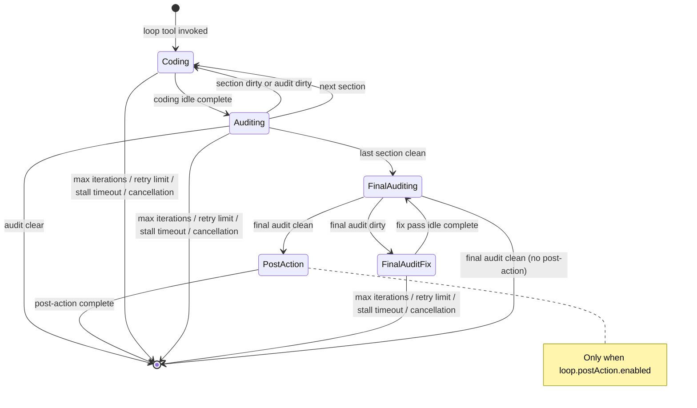
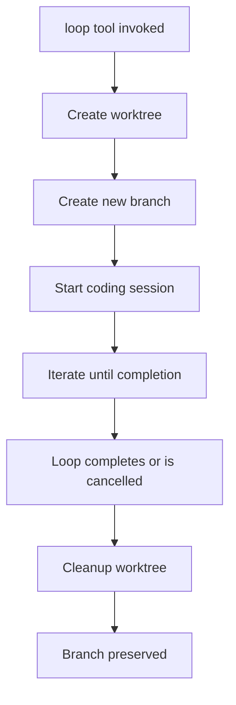

# Loop System Documentation

The loop system provides autonomous iterative development with automatic code auditing.

## Loop Lifecycle Rules

### Plugin Boot Behavior

- **Plugin boot does not mutate loop rows.** Initialization loads storage and runtime services only.
- No loops are recovered, cancelled, restarted, or reconciled during plugin startup.
- **Plugin boot does not mutate goals either.** A goal is advanced only by a loop's `settled` notification or an explicit `goal-status restart`; startup never resumes, re-plans, or reconciles one.
- Loop recovery and restart are explicit user actions via `loop-status restart=true`.

### Restartability

- **Any non-completed loop is restartable** via explicit restart when the worktree is available.
- Restartable statuses: `running`, `cancelled`, `errored`, `stalled`.
- **Completed loops are history-only** and cannot be restarted.
- **A missing worktree blocks restart only when the scratch branch is gone too** — if the branch survives, restart recreates the worktree from it (`git worktree add <branch>`); when both are gone the work is unrecoverable.

### Restart Semantics

- Restart preserves loop identity, plan, worktree path, section progress, review findings, and per-loop sandbox settings (a loop launched with the sandbox off stays off; its resource overrides apply if the sandbox is recreated).
- Restart resets the iteration count to 1 and clears the error budget.
- Restart creates a fresh session and preserves the section index. An ordinary `auditing` phase restarts as `coding`, while `final_auditing`, `final_audit_fix`, and an enabled `post_action` phase are preserved.
- Restarts into section coding with outstanding bug findings for the current section use the continuation prompt, including full finding details and the shared remediation policy; without current-section bugs, they use the initial section prompt.

### Stale Workspace Sweep

- Stale workspace sweep is **teardown cleanup-only**, not boot-time recovery.
- Sweep removes workspace registrations for non-running restartable loops (`cancelled`, `errored`, `stalled`) while preserving worktrees for manual restart.
- Completed loops are fully removed (registration + worktree).
- Running loops are never touched by sweep.

## Loop Lifecycle



### Phases

A loop has five persisted phases:

1. **`coding`** — a code session works on the current section or plan.
2. **`auditing`** — the auditor reviews the change against conventions and stored findings.
3. **`final_auditing`** — audits the whole accumulated diff (sectioned plan loops only).
4. **`final_audit_fix`** — a coding pass that fixes final-audit findings without a section rewind.
5. **`post_action`** — an optional best-effort action after a clean audit.

Each completed code or audit pass rotates to a fresh session, and audit findings feed back into the next coding iteration.

## Loop States

Each loop has a `LoopState` backed by the typed `loops` and `loop_large_fields` SQLite tables:

```typescript
interface LoopState {
  active: boolean                    // Whether loop is currently running
  sessionId: string                  // Current OpenCode session ID
  loopName: string                   // Unique loop identifier
  worktreeDir: string                // Worktree path
  projectDir?: string                // Project directory path
  worktreeBranch?: string            // Branch name if using worktree
  iteration: number                  // Current iteration count
  maxIterations: number              // Maximum iterations (0 = unlimited)
  startedAt: string                  // ISO timestamp
  prompt?: string                    // Original task prompt
  phase: 'coding' | 'auditing' | 'final_auditing' | 'final_audit_fix' | 'post_action'
  lastAuditResult?: string           // Last audit output
  errorCount: number                 // Consecutive error count
  auditCount: number                 // Number of audits completed
  terminationReason?: string         // Reason for termination
  completedAt?: string               // ISO timestamp
  worktree?: boolean                 // Whether using worktree isolation
  modelFailed?: boolean              // Whether model error occurred
  sandbox?: boolean                  // Whether using msb sandbox
  sandboxContainer?: string          // Sandbox name if sandboxed
  completionSummary?: string         // Summary of loop completion
  executionModel?: string            // Model used for execution
  auditorModel?: string              // Model used for auditing
  auditorFallbackIndex?: number      // Index into the auditor model fallback chain
  workspaceId?: string               // OpenCode workspace ID
  hostSessionId?: string             // Host session ID for post-completion redirect
  currentSectionIndex: number
  totalSections: number
  finalAuditDone: boolean
}
```

## Session Rotation

Each iteration runs in a **fresh session** to keep context small and prioritize speed:

1. **Coding phase** completes
2. Current session is destroyed
3. New session is created
4. Continuation prompt is injected with:
   - Original task prompt
   - Current iteration number
   - Audit findings (if any)

Rotated sessions are deleted from the OpenCode server right after their usage is captured, so a running loop has exactly one session: the current one. When a loop completes and its worktree is removed, its final session is deleted too, and the TUI removes any loop session whose worktree directory no longer exists. Loop sessions therefore drop out of OpenCode's session list once the loop moves on; loop history lives in `loop-status` and the [Dashboard](dashboard.md). A TUI can briefly keep showing deleted loop sessions from its local cache or tabs until it next refreshes the list from the server.

Continuation prompts are built by `buildContinuationPrompt` in `src/loop/prompts.ts`, which routes sectioned loops to the section continuation prompt and non-sectioned plan loops to the generic iteration prompt. Each variant composes the loop notice, the persisted attempt history, the outstanding review findings read from the review store (bug findings scoped to the current section for sectioned loops), and any recurring-findings block. Findings are inlined in full through the shared finding renderer; the auditor's response prose is never injected into a coder prompt.

## Usage Tracking

Loop usage is captured across rotated code and auditor sessions so `loop-status` can report cumulative cost and token totals after the original session has been replaced.

- `token-usage.ts` extracts assistant message usage, normalizes token fields, and groups totals by model label.
- `loop_session_usage` persists per-session, per-model rows keyed by project, loop name, session ID, and role.
- `loop-status <name>` merges persisted rows with the currently live session output while avoiding double-counting the active session.
- When no loops are active, `loop-status` can still show cumulative usage for completed loops that have persisted usage data.

Tracked token buckets are input, output, reasoning, cache read, and cache write, plus cost and assistant message count. Totals are reported three ways: overall, per model, and per role (`code`, `auditor`, `unknown`) derived from the `role` column, so execution and audit spend can be compared for the same loop.

## Stall Detection

A watchdog monitors loop activity and distinguishes two ceilings:

- `stallTimeoutMs` (default: 60 seconds) applies to ordinary stalls where no session registered to the loop is busy; the current phase is re-triggered through the ordinary recovery path.
- `busyStallTimeoutMs` (default: 900000 ms, 15 minutes) bounds a busy stretch without progress. Real activity resets the stretch; newer streamed content (reasoning included) extends it. A busy session that exceeds it is nudged, and `busy` alone never resets the stall counters.

```typescript
const STALL_TIMEOUT_MS = 60_000
const BUSY_STALL_TIMEOUT_MS = 900_000
const MAX_CONSECUTIVE_STALLS = 5
```

Retries reset the activity timer and suppress the ordinary recovery path; a provider-limit retry is either absorbed through model fallback or terminates the loop. A queued prompt suppresses the ordinary non-busy recovery tick. After 5 consecutive stalls, the loop terminates with `terminationReason: 'stall_timeout'`.

## Review Finding Persistence

Audit findings survive session rotation via the **review store**:

```typescript
interface ReviewFinding {
  projectId: string
  file: string
  line: number
  severity: 'bug' | 'warning'
  description: string
  scenario: string | null
  loopName: string | null
  sectionIndex: number | null
  createdAt: number
}
```

At the start of each audit:
1. Existing findings are retrieved via `review-read`
2. Resolved findings are deleted via `review-delete`
3. Unresolved findings are carried forward

Outstanding `severity: 'bug'` findings block completion of a sectioned plan loop; non-sectioned plan loops require zero outstanding findings of any severity. The loop terminates only when the auditor has run at least once and no blocking findings remain.

## Worktree Isolation

Loops always run in an isolated git worktree. Sandbox is optional and controlled by `sandbox.enabled` (default `true`) with driver `sandbox.mode = 'msb'`: when enabled, a sandbox is provisioned automatically. If the `msb` CLI is unavailable or the host cannot run microVMs, sandbox startup fails and the loop start is rolled back rather than silently falling back to the host; set `sandbox.enabled: false` to run worktree-only.

Worktree loops require a repository with at least one commit. If OpenCode started before the initial commit, it resolves the project as `global`; create the commit, restart OpenCode, and retry. Forge rejects `execute-plan` loop mode, TUI loop launch, and the launch of a goal chunk before creating workspaces or sessions when this precondition is not met.

Every loop records a **`base_commit`** — the worktree `HEAD` resolved right after the workspace is created — and preserves it across restart. It is the exact commit the worktree branched from, so an audit scopes to `git diff <base_commit>` (committed, staged, and unstaged tracked changes) plus untracked files instead of relying on a branch merge-base. The final audit, the final-audit fix prompt, and the non-sectioned audit prompt all use this scope, and the final-audit invocation's `Review scope:` line states the exact base commit. Rows persisted before base commits were recorded fall back to the legacy merge-base wording.

> Note: this applies to the `execute-plan` tool's default `mode: loop`. The same tool also accepts `mode: new-session`, which bypasses the loop entirely and runs the plan in a fresh standalone session with no worktree or sandbox (see [Tools Reference](tools.md#execute-plan)).



Benefits of worktree isolation:
- Isolation from ongoing development
- Safe to experiment without affecting main branch
- Branch preserved for later review/merge
- Per-loop customization via `loop.worktreeOpencodeConfig` — inject MCP servers and other [opencode config](https://opencode.ai/config.json) into each worktree without host config changes or commit pollution (see [Configuration Reference](configuration.md#worktree-opencode-config))

## Sandbox Integration

Sandbox is optional and controlled by `sandbox.enabled` (default `true`): when enabled, a sandbox is provisioned automatically. If the `msb` CLI is unavailable or the host cannot run microVMs, sandbox startup fails and the loop is rolled back rather than falling back to the host; set `sandbox.enabled: false` to run worktree-only.

1. Sandbox created with the worktree mounted at its identical host path
2. `shell`, `glob`, `grep` tools redirect into the sandbox
3. `read`/`write`/`edit` operate on host filesystem
4. Sandbox stopped and removed on loop completion

See [sandbox documentation](architecture.md#sandbox-system) for details.

## Milestones (aka sections)

In user-facing language, a plan is decomposed into **milestones** — ordered units of execution. In the code and database, these are called **sections**:

- `section_plans` SQL table — one row per milestone, ordered by `sectionIndex`
- `currentSectionIndex` / `totalSections` columns on the loop row
- `<!-- forge-section -->` markers in the architect plan output
- `section-read` tool reads the current or specified milestone, or with `pending_suffix: true` the ordered pending sections after the current one

Titles are display labels, not executable requirements — the content under each section is. After a `plan-adjust` amendment the live section rows form the **effective plan** that supersedes the master plan's original per-section instructions, while the master objective and top-level Verification remain authoritative.

Decomposition is a one-shot preprocessing step at loop start (`services/deterministic-decomposer.ts`), not a runtime loop phase. A plan is capped at `MAX_TOTAL_SECTIONS` (24) executed milestones; markers past the cap are dropped rather than merged, so the tail of an over-long plan is not executed. The same constant caps `plan-adjust` amendments, so a plan can never grow past it mid-loop. Once milestones exist, the loop advances through them via `advance-section` transitions inside the `auditing` phase. When the `final_auditing` phase reports outstanding bug findings, the loop rotates to a coding session in the persisted `final_audit_fix` phase — the code agent fixes the reported findings without rewinding to a specific section, and on idle the loop transitions straight back to `final_auditing` for re-verification. A loop stopped mid-fix restarts as a coding pass that re-sends the final-audit fix prompt (rebuilt from the persisted outstanding findings).

### Plan Amendments

After decomposition, the plan can still be amended mid-loop: during a section audit, the auditor may call the `plan-adjust` tool to revise the section currently under audit (`currentSection`, edited in place with its progress preserved) and/or replace the pending section suffix (`sections`, which is destructive — an omitted milestone is deleted). The stored master plan row is unchanged, so the master objective and top-level Verification remain authoritative; the amended current/pending sections form the effective plan that supersedes the original per-section instructions. `plan-adjust` performs no semantic validation of the amended instructions; auditor policy forbids weakening acceptance criteria merely to obtain a clean audit. Already-completed sections cannot be changed, non-sectioned loops are excluded, and the resulting total is capped at 24 sections. Every amendment is recorded in the `plan_amendments` table with before/after snapshots and a rationale. Amendments are only accepted while the loop is in the `auditing` phase; `plan-adjust` remains rejected outside section auditing — including the final audit — so no final-audit amendment can append sections.

### Transition Log

Every persisted phase change appends exactly one row to the `loop_transitions` table (event type, transition kind, from/to phase, iteration, section index, and terminal status/reason for terminate rows). The dashboard renders this log as a live state-machine graph with per-edge traversal counts. Transition history survives loop restarts (loop rows are restored in place, never delete+reinserted) but is removed with the loop row by the terminal-loop sweep.

## Completion Conditions

A loop completes when the active phase emits a clean audit result (optionally followed by a post-completion action phase):

- Non-sectioned loops complete on `audit-clear`.
- Sectioned loops advance through clean section audits, then complete on `final-audit-clean`.
- Dirty section audits rotate back to coding for the same section so findings can be addressed.
- Dirty final audits rotate to a coding session in the `final_audit_fix` phase (no section rewind); when the fix coding pass goes idle, the loop returns straight to `final_auditing`.
- After a clean audit — a clean final audit for sectioned loops, `audit-clear` for non-sectioned plan loops — if `loop.postAction.enabled` is `true` and specifies a `skill` or `prompt`, the loop enters a `post_action` phase that runs inside the worktree before teardown. Normal confirmed completion (`post-action-complete` event) occurs once the post-action session is idle, every loop session has settled, and the final reply confirms completion; see [Behavior](#behavior) for the best-effort completion that follows exhausted or failed continuation attempts and the abort-with-reply exceptions.

## Termination

In addition to a clean audit, the loop terminates when:

- **Max iterations** — The `maxIterations` cap is exceeded (0 = unlimited).
- **Stall timeout** — After `maxConsecutiveStalls` consecutive stalls (default: 5). Use `loop-status` with `restart` to resume from the persisted section and iteration.
- **Consecutive errors** — 3 consecutive errors in either phase.

## Post-Completion Action Phase

After a clean audit (a clean final audit for sectioned loops, `audit-clear` for non-sectioned plan loops), before worktree teardown, the loop may run a **post-completion action** configured via `loop.postAction` in `forge-config.jsonc`. This phase is best-effort — it is not re-audited. When a skill is configured, that skill's unattended workflow governs its fixes and validation; without one, it relies only on safe, scoped fixes. The post-action runs as the `code` agent in a fresh session inside the worktree.

```jsonc
{
  "loop": {
    "postAction": {
      "enabled": false,       // Enable the post-completion action phase
      "skill": "pr-review",   // Skill to load via the Skill tool (e.g. "pr-review")
      "prompt": "..."         // Extra instruction text; used standalone when no skill is set
    }
  }
}
```

### Configuration

| Field | Type | Default | Description |
|-------|------|---------|-------------|
| `loop.postAction.enabled` | `boolean` | `false` | Enable the post-completion action phase. |
| `loop.postAction.skill` | `string` | — | Name of a skill to load via the Skill tool at action time (e.g. `"pr-review"`). Must be installed host-side. |
| `loop.postAction.prompt` | `string` | — | Optional extra instruction text appended to the action prompt. Used standalone when no skill is set. |
| `loop.postAction.model` | `string` | — | Optional `provider/model` for the post-action session, sent without a variant. Falls back to the loop's auditor model — with the auditor's variant — when unset or when the configured model fails. |

### Behavior

- Runs only after a clean audit completes (a clean final audit for sectioned loops, `audit-clear` for non-sectioned plan loops).
- Runs **inside the worktree** as the `code` agent, with access to the full worktree state (including uncommitted changes).
- **Best-effort:** The post-action result is not re-audited. When a skill is configured, that skill's unattended workflow governs the fixes and validation; without one, the phase applies only safe, scoped fixes. The question tool is blocked — any finding requiring clarification is auto-deferred.
- **Completion confirmation:** The prompt requires the agent to finish every step (subagents, merges, saved records) before ending its turn, and to end its final reply with the line `<!-- forge:post-action-complete -->` (`POST_ACTION_COMPLETE_MARKER` in `src/loop/prompts.ts`). When the session goes idle, Forge first waits until every loop session, subagents included, is idle and no prompt is queued in the session inbox; the wait is bounded by `busyStallTimeoutMs`, after which the loop terminates with an error because the worktree cannot be torn down safely. It then checks the final reply for the marker. Without it, Forge sends a continue prompt asking the agent to finish, up to 3 times; after the third, or if the continue prompt fails to send, the loop completes best-effort.
- On a confirmed (or best-effort) `post-action-complete`, the loop terminates normally.
- If the post-action session is aborted after it has replied, the reply is processed as-is: the settle wait and marker check are skipped.
- If the post-action session fails to create, the loop terminates as completed without retrying.
- **Outcome capture:** On `post-action-complete`, the post-action session's full assistant transcript (including any continue-prompt turns) is stored in the loop's `postActionReport`, and its final assistant message, with the completion marker removed, is stored in `completion_summary`. `loop-status` and the dashboard prefer the full **Post-Action Report** and fall back to **Completion Summary** when no report was captured. The loop status is **always** `completed` regardless of what the post-action reported — the plan itself was already cleared by the audit; the report only provides context (alternate-review verdict, CI result, etc.). Completion summary and report are captured only on the clean `post-action-complete` path; idle-exhausted, error, and abort-without-assistant terminations leave them empty.

## Goals

A **goal** is an objective executed as a sequential series of ordinary plan loops called **chunks**. The orchestrator runs one chunk at a time, each stacked on the previous chunk's branch, until every task is done, the planner declares the goal complete, or the goal is paused.

### Defining a goal

The `/goal <objective>` command runs as the `architect` agent. It:

1. Resolves the work strictly read-only with the tools already in the session (`gh issue list`/`gh issue view`, a tracker's MCP tools, or a plain task breakdown), never commenting on, assigning, labelling, transitioning, or closing a ticket.
2. Settles the route after researching the goal: the objective is the fixed outcome, so the rounds settle how to reach it. It calls `question` with one grouped set of questions that settles the route — one per decision group (placement and ownership, reuse versus extending versus new code, data and interface shape, edge-case and error policy, sequencing, verification strategy, plus any group research surfaced), each with 2–4 research-backed options and the recommended one first — and repeats a fresh grouped round after each answer set, re-researching newly opened paths, until every route decision is settled. These rounds also cover chunk 1.
3. Orders the tasks dependencies-first, **one task per chunk** (two tickets merge into one task only when they cannot be implemented separately).
4. Saves the draft with `goal-write` — title, objective (the objective verbatim followed by a `Route decisions:` list of every settled route decision), the ordered task list, and an optional `maxChunks`. Later `architect-auto` chunks treat those recorded route decisions as binding.
5. Plans **chunk 1 only** with `plan-write`/`plan-edit`, naming the goal and the task ref in the Objective.

Later chunks are never planned up front: each is planned against the code the previous chunks produced.

### Launching chunk 1

Launching that plan as a loop from the drafting session — through **any** surface: the TUI execution dialog, the plan-approval `Loop` path (which instructs the architect to call `execute-plan`), or the `execute-plan` tool directly — attaches it as **chunk 1**. The draft is promoted to `running`, the chunk records the loop name, branch, and base commit, and the goal snapshots the launch settings from that first chunk: execution/auditor model and variant, sandbox settings, `maxIterations`, and the project directory. Every later chunk reuses that snapshot.

### Chunk lifecycle

Each chunk is a normal plan loop: sections, final audit, and the configured `loop.postAction` all run as usual, and teardown is unchanged — commit, sandbox stop, worktree removed on completion, and the `forge/<loop>` branch kept. There is no goal-specific post-action and no goal-specific audit.

### Advancement on `settled`

Goal advancement is driven **only** by the loop-change `settled` notification, which fires once a loop's termination side effects — the teardown commit, sandbox stop, and worktree cleanup — have finished. The earlier `terminate` notification (fired when the terminal status is persisted, before teardown) never advances a goal, so a chunk's work is always committed before the next chunk is based on it.

On `settled` for a **completed** chunk loop:

1. The chunk is marked `completed` with a capped summary — the loop's `completionSummary`, else its `postActionReport`, truncated to `GOAL_CHUNK_SUMMARY_MAX_CHARS`.
2. A detached, read-only planning checkout of the previous chunk branch tip is created at `<dataDir>/worktrees/.goal-plan-<goalId>-<chunkIndex>`.
3. `architect-auto` plans the next task there with the goal's **auditor** model and variant; the planner prompt carries the objective, the ordered task list, and the completed-chunk summaries. The planner runs unattended, so any request OpenCode would `ask` about is denied before per-session or sandbox auto-approve applies, with `Blocked in goal planning: the chunk planner runs unattended, so requests that need approval are denied. Continue without it and report what was skipped.` OpenCode `allow` and `deny` decisions are untouched. The planner either:
   - **writes a plan** — the chunk loop launches with `baseRef` set to that exact commit and the snapshotted settings, so each chunk gets its own branch stacked on the previous chunk's commit;
   - **emits `<!-- forge-goal:complete -->`** (`GOAL_COMPLETE_MARKER`) — the goal is marked `completed`;
   - **fails** — the goal is **paused** with the reason.

Why a plain detached checkout instead of a Forge workspace: a Forge workspace with no matching loop row is reclaimed by the stale-workspace sweep after a 5-minute grace window, so a planning workspace would be removed out from under the planner.

Planner failures pause the goal. A normalized `session.error` for a chunk planner session — a provider failure or an interrupted/aborted execution — or an execution OpenCode interrupts for inactivity pauses the goal with `Planner failed for chunk <n>: <reason> (kept planner session <id> and checkout <dir> for inspection; goal-status restart discards them and re-plans chunk <n>)`. The chunk stays in stage `planning`, and its planner session, stored plan, and detached planning checkout are kept for inspection; `goal-status restart` (no `force` needed) discards them and re-plans the chunk, and cancelling the goal also cleans them up. A later idle for that session is a no-op because the goal is paused. Other planning failures — no stored plan, an insufficient brief, or a loop start failure — still discard the planning resources. A premature idle that yields neither assistant text nor a stored plan leaves the chunk planning rather than failing it.

### Pause, resume, restart, and cancel

- A chunk loop that ends **not completed** (cancelled, errored, stalled, or with a missing worktree) pauses the goal. Restarting that loop with `loop-status restart=true` and completing it resumes the goal automatically.
- Reaching `maxChunks` (default `20`, hard max `100`) pauses the goal; raise the cap with `goal-status restart` and `maxChunks`.
- **No automatic retries.** Every failure pauses the goal and waits for an explicit action; plugin boot never mutates a goal.
- If the running chunk's loop row is gone (swept or deleted), `goal-status restart <goalId>` cancels that chunk, advances the goal from the last completed chunk, and names the abandoned branch in its message.
- Recovery is `goal-status restart <goalId>`: it re-plans an interrupted planning chunk, catches a missed settle (a completed chunk loop that never advanced the goal), and — with `force` — discards planning still marked in flight. `maxChunks` raises the cap.
- `goal-status` list and detail show the current chunk's loop status whenever that loop is resolvable and not running, with the restart hint; a cancelled chunk is never shown as the current chunk.
- `goal-cancel <goalId>` cancels the goal, cleaning up any planning chunks and optionally cancelling the running chunk loop.

### `execute-plan` loop vs `/goal`

| Aspect | `execute-plan` loop | `/goal` |
|---|---|---|
| Input | One stored plan | An objective plus an ordered task list |
| Unit of work | One loop, decomposed into sections | A sequence of chunk loops, one per task |
| Who plans the next unit | The plan's sections (deterministic decomposer at loop start) | `architect-auto` after each chunk settles |
| Branching | One worktree and branch | One worktree and branch per chunk, stacked on the previous chunk's commit |
| Advancement trigger | Section transitions inside the loop | The `settled` notification after each chunk's teardown |
| Slash command | `/execute-plan` | `/goal` |

> **Upgrading:** migration 150 deletes every old goal-kind loop row — including running or restartable ones — together with its per-loop data, and migration 151 drops the feature-group tables (`feature_groups`, `group_features`). The orphaned worktrees are later removed by the stale-workspace sweep **without a commit**, so uncommitted work in such loops is lost. Finish or cancel any goal loops before upgrading to this version.

## Cancellation

Loops can be cancelled via:
- `loop-cancel` tool
- `/loop-cancel` slash command

Cancellation:
1. Marks loop as inactive
2. Sets `terminationReason` to `'cancelled'`
3. Stops sandbox if applicable
4. Optionally cleans up worktree (if `cleanupWorktree: true`)

## Error Handling

| Error Type | Behavior |
|------------|----------|
| Model error | Automatic fallback to default model, retry |
| Error retry limit | Loop terminates with `terminationReason: 'error_max_retries'` |
| Audit retry limit | Loop terminates with `terminationReason: 'audit_retry_exhausted'` |
| Final audit retry limit | Loop terminates with `terminationReason: 'final_audit_retry_exhausted'` |
| Stall timeout | Loop terminates with `terminationReason: 'stall_timeout'` after the configured consecutive stall limit |

## Model Configuration

Model and variant selection follows this priority order (first match wins):

**Execution model:**

1. In-session dialog override (instance lifetime)
2. `config.executionModel`
3. Last-used loop preference
4. Platform default

**Auditor model:**

1. In-session dialog override (instance lifetime)
2. `config.auditorModel`
3. `config.executionModel`
4. Last-used auditor model
5. Last-used execution model
6. Platform default

Variants use override → matching config value → last-used loop value. The auditor variant does not inherit the execution variant. When launching from the TUI dialog, your selection is remembered and pre-filled on subsequent launches, and the dialog allows selecting a separate model for the auditor phase. On model errors during execution, automatic fallback to the default model kicks in.

## Management

- **Slash commands**: `/execute-plan` to start, `/loop-cancel` to cancel.
- **Tools**: `execute-plan` to start with parameters, `loop-status` for checking progress (with restart capability), `loop-cancel` to cancel.
- **Loop names**: a new loop start reserves a unique name (`src/loop/name-uniqueness.ts`) that no goal chunk references (`goal_chunks.loop_name`) and that has no live `forge/<name>` branch, taking a `-N` suffix; a restart reuses its own name and branch.
- **Cleanup**: terminal loops and their loop-scoped plans are swept automatically once `completedLoopTtlMs` passes after completion. Completed and cancelled goals and their chunks are swept after the same TTL, as are draft goals not updated within it; running and paused goals are never swept. Session-scoped plans have no TTL and are removed by `bun scripts/cleanup-plans.ts [--older-than=30d] [--project=<id>] [--dry-run]` (bulk purge) or from the dashboard's Plans section on a loopback bind; `bun scripts/cleanup-loop.ts <loopName>` wipes one loop's row, its plans, worktree, branch, and sandbox. These scripts are source-checkout only, like `pnpm dashboard`.

## Tool Restrictions

Inside active loop sessions:
- `git push` is not denied by default; add a scoped `loop.permissions.deny` entry such as `{ "permission": "bash", "pattern": "git push *" }` to deny it
- `execute-plan` is blocked (tool hooks)
- `question` is blocked (tool hooks)
